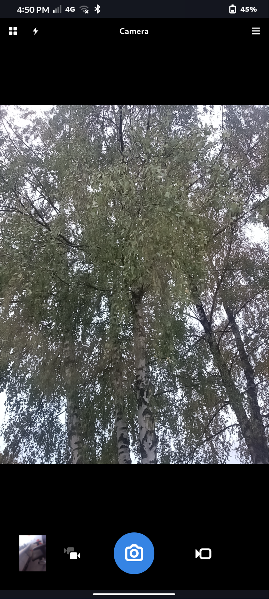
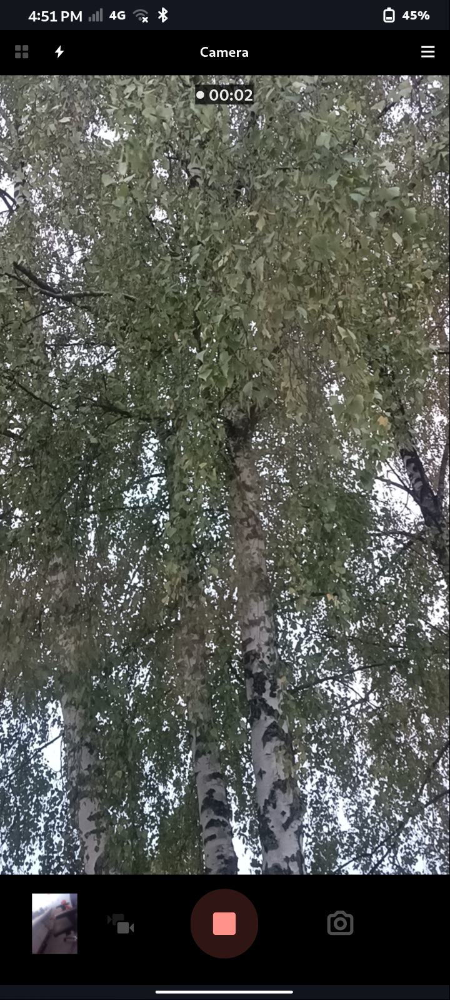

# Camera

A GTK4/libadwaita camera application for FuriOS and other Halium-based Linux
phones (maybe, the only other phone I can test is the Pixel 3a running Droidian and it doesn't work there).

Camera drives the [FuriCam](https://github.com/nico359/furicam) Camera2 engine
from a native GTK4 frontend. The 0.1.0 milestone proves the stack end to end:
a real Camera2 viewfinder, full-resolution stills and hardware-encoded video
inside a Flatpak. Feature parity with FuriCam or at least close to it is planned. Might abandon FuriCam for this at some point because furios-camera will keep developing as well but let's see.

<p>
  
  
</p>

## Features

- live preview through `GtkGLArea`, letterboxed to the still aspect ratio and
  redrawn at the engine's capture rate (30 fps)
- full-resolution JPEG capture (the engine asks the sensor for its largest
  JPEG stream; on the FuriPhone this is 5152×3864)
- asynchronous capture feedback: the UI reports when the JPEG is actually
  written, not when the request is submitted
- a last-media thumbnail that opens through the system OpenURI portal; the
  first open may show the app chooser, after which the portal remembers the
  choice per content type. The “Ask Which App to Open Media” switch in Settings
  forces the chooser again
- black preview canvas and header bar; the preview sits above a dedicated
  control bar, so it is centered between the header and the shutter row rather
  than behind the controls
- portrait-locked preview with its aspect ratio derived from the active
  sensor orientation; video mode switches the preview to 16:9
- 1080p or 4K H.264 recording with a live viewfinder, record/stop button and
  timer; it requests 30 fps but the HAL may pick a lower AE rate in low light.
  AAC audio is included when the build finds GStreamer. 4K may be unstable on
  this HAL and is marked as such in Settings
- camera switching while idle in video mode; cameras that cannot do video fall
  back to photo mode with a warning
- pinch zoom (also `+`/`-`) with a zoom indicator
- tap-to-focus with a reticle; `F` focuses the center. Focus is applied on
  release and only for a stationary tap, so swipes and pinches don't trigger it
- flash menu in the header: Off / On / Torch; On uses the still flash,
  Torch is continuous, and front cameras disable the menu. With flash On,
  tap-to-focus uses a brief AF-assist torch and turns it off once focus settles
- a Settings dialog in the hamburger menu with per-camera photo resolution
  using every advertised JPEG size/aspect (typically 4:3 and 16:9, plus any
  other native sizes the camera exposes), JPEG quality tiers
  (Original/Balanced/Medium/Small), video resolution (1080p/4K), an optional
  video stabilization (EIS) switch, a 3×3 composition grid toggle, a bubble
  level, and the “Ask Which App to Open Media” preference. The quality tiers
  map to the camera's JPEG quality 100/70/40/20; they are deliberately names
  rather than percentages because the HAL chooses the actual compression, and
  the JPEG is written by the HAL directly without an on-disk re-encode
- video files are written to `~/Videos/Camera/VID_*.mp4`; the thumbnail opens
  photos or videos through the system portal
- device-rotation-aware still capture through iio-sensor-proxy
- flip (front/back) button in the bottom row beside the shutter, and a camera
  picker in the header that includes every enumerated camera, including the
  secondary back camera
- front-camera preview mirroring
- a Flatpak manifest with the permissions the Halium camera stack needs

## Roadmap

Not implemented yet:

- gallery, HDR, RAW, and the manual exposure/ISO/shutter “pro” controls. The
  engine already exposes most of these through its C API; the UI is the
  remaining work.

Known limitations:

- Flash **On** uses the engine's still-flash path but does not run FuriCam's
  full preflash/AF-assist capture sequence yet.
- Video frame rate can drop in low light because the engine's AE range is
  15–30 fps.
- 4K recording may be unstable on this HAL; 1080p is the safe default.
- Video stabilization (EIS) crops the video field of view; it is off by
  default in Settings.
- The level uses SensorFW (`com.nokia.SensorService`). If that service is
  unavailable, the bubble has no readings.
- The preview is portrait-locked by design; saved photos and videos follow the
  device tilt.
- The Flatpak is self-hosted because it needs `--device=all` and the Halium
  paths, so it is not suitable for Flathub (also vibe coded as hell).

## Building

### Desktop / non-Halium

The default build does not compile the Camera2 engine; it uses a no-camera
backend so the GTK UI can be developed and tested without libhybris.

```sh
meson setup build
meson compile -C build
```

### FuriOS / FuriPhone Flatpak

The Flatpak build enables the Camera2 backend:

```sh
sudo flatpak-builder --system --install --force-clean builddir io.github.nico359.camera.json
flatpak run io.github.nico359.camera
```

Use `--user` instead of `--system` if the SDK, runtime and Rust extension are
installed in the user installation.  The SDK and extension are system-wide on
FuriOS, so `--system` is the default here.

Requirements:

- `org.gnome.Sdk//51` and the matching Rust extension.  The SDK metadata
  declares `org.freedesktop.Sdk.Extension` version `26.08`, so install
  `org.freedesktop.Sdk.Extension.rust-stable//26.08`.
- On FuriOS, the Flatpak setup already injects `/android`, `/system`, `/vendor`
  and `/dev/binder` into every sandbox.  The manifest only asks for
  `--device=all`; without that FuriOS integration the app can build but will
  not find the camera HAL.
- The Flatpak is self-hosted on purpose.  `--device=all` and the Halium paths
  make it unsuitable for Flathub.
- The thumbnail uses the system OpenURI portal.  It does not request the broad
  `org.freedesktop.Flatpak` host-exec permission.  The first open may show an
  app chooser; the portal remembers the choice per content type afterwards.

The camera engine links `libhybris` at runtime through the
`org.freedesktop.Platform.GL.hybris` extension; it does not copy host libraries
into `/app`.

Release builds use Cargo's `release` profile with LTO, a single codegen unit
and stripped symbols. The Flatpak manifest already builds with
`-Dbuildtype=release`.

## Configuration

`meson_options.txt` has one option:

```sh
meson setup build -Dcamera2=true
```

`camera2` is only useful on Halium devices.  It compiles the vendored engine in
`src/engine/camera2` and requires EGL headers in the build environment.

Audio recording is enabled automatically when `pkg-config` finds
`gstreamer-1.0` and `gstreamer-app-1.0`.  Without them the engine builds its
video-only AAC stub and recording still works, just without sound.

## Credits

- The Camera2 engine is vendored from
  [FuriCam](https://github.com/nico359/furicam) and was also mostly vibe coded and contributed by Sean Pollard.
  FuriCam is based on
  [FuriOS-camera](https://github.com/FuriLabs/furios-camera) by Furi Labs.
- Overall design inspiration was taken from [GNOME Snapshot](https://gitlab.gnome.org/GNOME/snapshot).
- The UI is built with GTK4 and libadwaita and follows GNOME design
  conventions.

## AI Disclosure

This application was built with the assistance of AI (OpenCode with DeepSeek).

## Licensing

The application is **GPL-2.0-or-later**.  The vendored FuriCam Camera2 engine
is **GPL-2.0-only**; see `src/engine/camera2/README.md`.  A binary that links
the engine is distributed under **GPL-2.0**.  The app code alone may also be
used under GPL-3.0-or-later, but distributing the combined work under GPL-3.0
would require permission from the engine copyright holders.

FuriCam itself is based on FuriOS-camera (`GPL-2.0-only`, Furi Labs/Droidian
Project) and remains GPL-2.0-only unless its copyright holders agree otherwise.
This is not legal advice.
